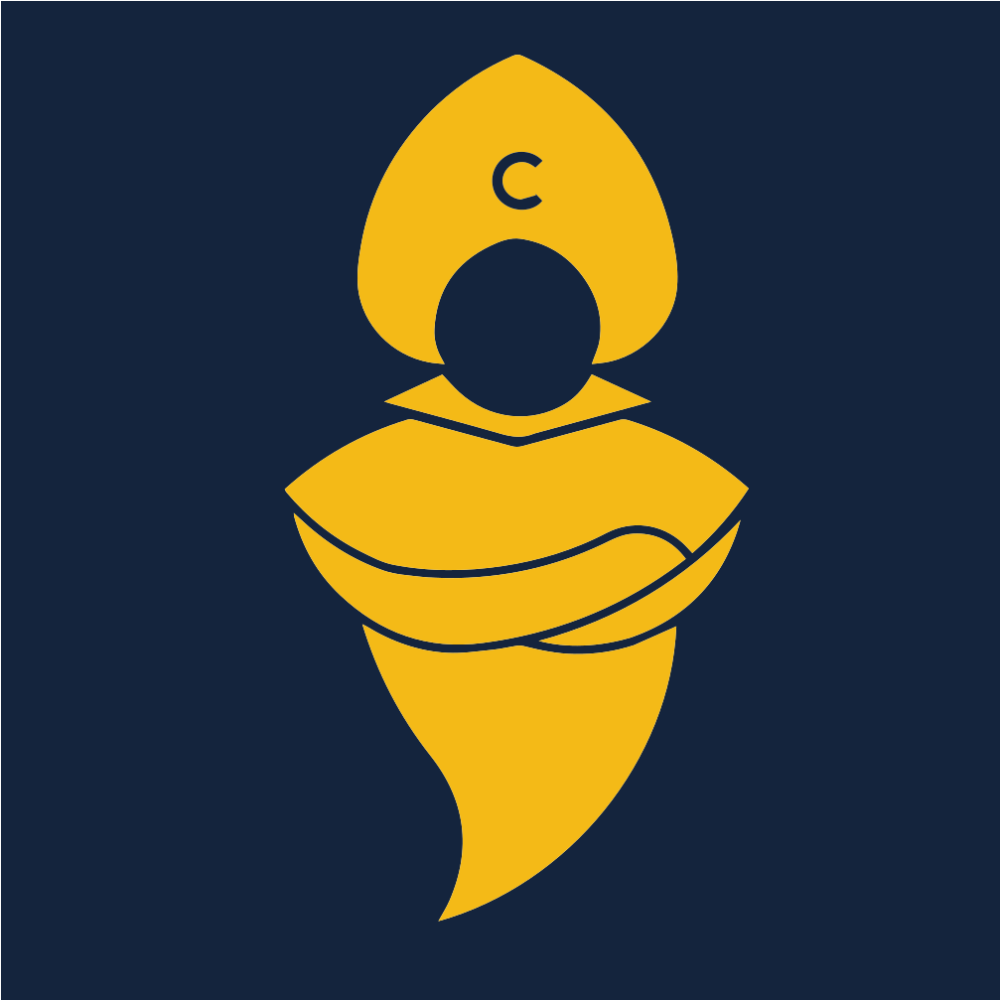

<p align="center">
  
</p>

<h1 align="center">CyberSkill Design System</h1>

<p align="center">
  Ink &amp; Gold tokens, accessible React components and patterns for every CyberSkill product.<br>
  <a href="https://design.cyberskill.world"><strong>design.cyberskill.world</strong></a>
</p>

<p align="center">
  <a href="https://www.npmjs.com/package/@cyberskill/design"></a>
  <a href="https://github.com/cyberskill-official/design/actions/workflows/ci.yml"></a>
  
</p>

## Install

```bash
npm install @cyberskill/design @phosphor-icons/react
```

```css
/* app/globals.css */
@import 'tailwindcss';                       /* optional */
@import '@cyberskill/design/tailwind.css';   /* optional, Tailwind v4 theme */
@import '@cyberskill/design/styles.css';
```

```tsx
import { Button } from '@cyberskill/design';

<Button variant="accent">Ask AI</Button>;
```

Full guide: [Get started](https://design.cyberskill.world/docs/get-started).

## What's inside

| | |
|---|---|
| **Tokens** | One JSON source for color, type, space, radius, shadow and motion. The build fails if text contrast drops below WCAG targets or two colors with different meanings look alike, including to color-blind readers. |
| **Components** | Built on [Base UI](https://base-ui.com) for keyboard, focus and screen reader behavior. Plain CSS in cascade layers: works with or without Tailwind and in Server Components. |
| **Charts, tables, forms, dates** | Optional entry points on Recharts, TanStack Table, React Hook Form and react-day-picker; apps that don't use them never load them. |
| **AI-ready** | The package ships compact docs for AI coding tools (`ai/INDEX.md`, one file per component, a Claude Code skill and a Cursor rule). Run `npx cyberskill-design ai-setup` in your app. |
| **Quality gates** | Every component is tested in a real browser with axe in light and dark, and every story also runs as a browser test with axe. The build fails on any broken contrast or color-distinctness rule. A forensic visual audit checks rendered contrast, clipping, overlap and touch targets on every site page in both themes. |

## Repository

| Path | |
|---|---|
| `packages/design` | The npm package `@cyberskill/design` |
| `apps/site` | design.cyberskill.world (Next.js + Fumadocs, static export) |
| `tools/audit` | Forensic visual audit |
| `tools/benchmark` | Quality benchmark: 22 dimensions on every story ([docs/benchmark.md](docs/benchmark.md)) |
| `examples/next-hello` | Smallest consumer app; CI installs the packed tarball into it |

```bash
npm install
npm run dev          # package in watch mode + site on http://localhost:3100
npm run storybook    # component workbench on http://localhost:6006
npm test             # component tests + stories in Chromium with axe
npm run site:build && npm run audit:visual
npm run build-storybook -w @cyberskill/design && npm run benchmark   # quality scorecard
```

Contributing: read [AGENTS.md](AGENTS.md) (the rules for humans and AI agents) and [CONTRIBUTING.md](CONTRIBUTING.md).

## Versions

- **3.x** (this branch): Ink & Gold.
- **2.x**: Umber & Ochre, on the [`legacy`](https://github.com/cyberskill-official/design/tree/legacy) branch and the `legacy` npm tag. Docs and Storybook: [design.cyberskill.world/legacy](https://design.cyberskill.world/legacy/). See [Migrating from 2.x](https://design.cyberskill.world/docs/migration).

## License

Proprietary. `UNLICENSED`: use is limited to the CyberSkill products listed in [docs/consumer-grant.md](docs/consumer-grant.md). See [LICENSE](LICENSE).
